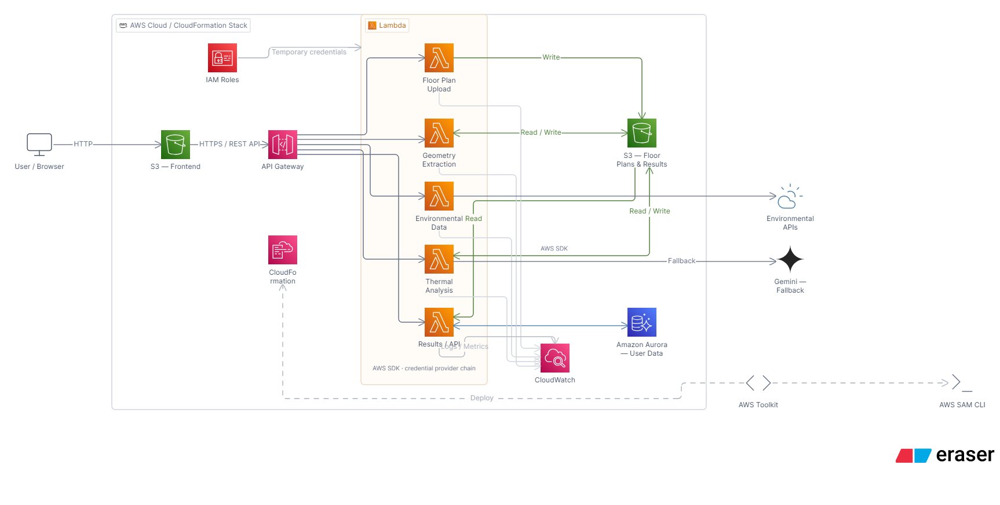

# Thermal Mapping for Sustainable Homes

  
  &nbsp; <strong>×</strong> &nbsp;
  

  <strong>Built for the AWS × WeMakeDevs Hackathon</strong>
   
  Making homes cooler through AI, environmental data, and AWS.

---

### The Idea

What if we could predict how hot a home might become **before it's even built?**

Our platform analyzes floor plans and local environmental data to visualize potential indoor heat distribution and identify opportunities for better ventilation, window placement, and passive cooling.

### How It Works

- **Floor-plan analysis:** Extract rooms, walls, windows, and doors.
- **Environmental intelligence:** Use weather, humidity, wind, and solar radiation data.
- **Thermal mapping:** Develop room-level temperature simulations and visual heat maps.
- **AI recommendations:** Explore smarter, energy-efficient design choices.

### AWS Architecture

  

We use **AWS SAM, AWS Lambda, Amazon API Gateway, Amazon S3, and AWS CloudFormation** to build our serverless foundation. We're also exploring **Amazon Bedrock** for AI-powered recommendations.

### Domain & Networking

We use **Cloudflare** for domain mapping and DNS management, helping connect our custom domain to the application and manage domain traffic.

### Our Vision

We want to help homeowners, architects, and builders reduce indoor heat and energy consumption from the design stage itself. Our future business model includes transparent sponsorships and partnerships with brands offering heat-reflective paints, insulation, and energy-efficient cooling products.

### Built With

**TypeScript · AWS · Cloudflare · Serverless · Environmental Data · AI · Thermal Simulation**

---

  <strong>Less heat. Less energy. Better homes.</strong>
   
  Built with curiosity at the AWS × WeMakeDevs Hackathon.

